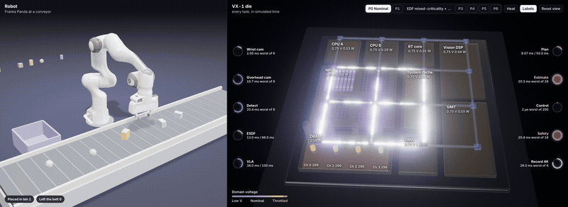

# Glass Chip

Glass Chip is a see-through, closed-loop performance and power model of a physical-AI system-on-chip running a live robot. A simulated Franka Panda picks parts off a moving conveyor, and every piece of its software stack (camera ingest, detection, a vision-language-action policy, cuRobo-style planning, a 1 kHz joint controller, a human-proximity safety monitor and ROS 2-style middleware) runs as jobs on a deterministic, multi-fidelity model of a fictional SoC called VX-1. A job's output reaches the robot only when the chip model says the job finished, so chip latency changes what the arm does. I built it to answer the questions a robot SoC performance team actually asks: does every task meet its deadline when fifteen things run at once, which resource caused a miss, how much slack can be turned into lower voltage, and how far can a fast model be trusted.



TEMPLATE: live demo URL goes here once the site is public (static replay plus in-browser surrogate).

The full technical report is [report/glass-chip-report.pdf](report/glass-chip-report.pdf) (source: [report/report.md](report/report.md)).

> VX-1 is a fictional reference SoC sized for a mid-range humanoid or arm controller, inspired by public descriptions of physical-AI SoCs. It is not any company's design. Every parameter is an assumption with a config key, and every accuracy statement below is relative to reference simulators (SCALE-Sim, gem5, Ramulator 2, BookSim 2), not silicon.

## Results first

All numbers come from `results/sNN.json`, written by the scripts in `studies/` against frozen core build `3e9cf32325432d0f`. `tools/numcheck.py` checks every one of them against its source field.

1. **Pacing to deadlines saves energy without misses.** In the nominal pick scenario (S1), the pace-to-deadline policy (P4) runs at 3.22 Wh per robot-hour against 4.52 Wh for nominal voltage (P0) and 3.46 Wh for race-to-idle (P3), with zero deadline misses over five seeds. <!-- src: results/s06.json#aggregate.S1.policies.P4.energy_per_robot_hour_wh.mean --> <!-- src: results/s06.json#aggregate.S1.policies.P0.energy_per_robot_hour_wh.mean --> <!-- src: results/s06.json#aggregate.S1.policies.P3.energy_per_robot_hour_wh.mean -->
   Five held-out seeds that never touched tuning give 3.21 Wh, also with zero misses. The offline lower bound (P5) on the same traces is 1.69 Wh, so there is still room. Under fifteen concurrent tasks (S6), P4 misses 26 non-safety jobs, so it is not free. <!-- src: results/s06.json#held_out.aggregate.S1.policies.P4.energy_per_robot_hour_wh.mean --> <!-- src: results/s06.json#aggregate.S1.policies.P4.p5_bound_wh.mean --> <!-- src: results/s06.json#aggregate.S6.policies.P4.misses_total -->
2. **The bandwidth wall is a scheduling problem first, then a thermal one.** With FIFO scheduling, a background recorder causes robot-stack deadline misses from 5.97 Gbit/s (raw 4K30) and VLA misses from 48 Gbit/s. <!-- src: results/s04.json#headline.robot_stack_first_miss_bitrate_gbps.P0 --> <!-- src: results/s04.json#headline.vla_first_miss_bitrate_gbps.P0 -->
   Up to 48 Gbit/s, EDF and mixed-criticality EDF (with or without NoC/DRAM QoS and cache partitioning) have no misses at all. <!-- src: results/s04.json#headline.robot_stack_first_miss_bitrate_gbps.P2 --> <!-- src: results/s04.json#points[34].bitrate_gbps --> <!-- src: results/s04.json#points[34].robot_misses -->
   At 96 Gbit/s the module draws about 9.75 W against 4.51 W in S1, the EDF variants now hit thermal throttling, and every configuration misses: FIFO has 976 robot-stack misses (187 safety), EDF 679 (123 safety), and EDF-MC with QoS and partitioning 90 with 0 safety misses. <!-- src: results/s04.json#points[35].avg_power_w.mean --> <!-- src: results/s01.json#headline.s1_avg_power_w --> <!-- src: results/s04.json#points[5].robot_misses --> <!-- src: results/s04.json#points[5].safety_misses --> <!-- src: results/s04.json#points[17].robot_misses --> <!-- src: results/s04.json#points[17].safety_misses --> <!-- src: results/s04.json#points[35].robot_misses --> <!-- src: results/s04.json#points[35].safety_misses -->
   Critical-path attribution over the S7 and S8 misses says why: 770 missed jobs were dominated by CPU run-queue waits and 244 by NoC waits. QoS and cache partitioning alone do not fix FIFO. <!-- src: results/s03.json#headline.dominant_wait_overall.runqueue --> <!-- src: results/s03.json#headline.dominant_wait_overall.noc -->
3. **Chip timing changes robot safety behavior, moderately.** With a 24 Gbit/s recording and FIFO, the safety monitor (T8) misses 17.4% of its deadlines and the human-to-slowdown p99 rises to 62.9 ms, against 37.0 ms and zero misses with EDF-MC, QoS and partitioning. <!-- src: results/s04.json#points[3].bitrate_gbps --> <!-- src: results/s16.json#part_a_safety_under_load["recording 24 Gbit/s | P0 FIFO"].t8_miss_rate|pct --> <!-- src: results/s16.json#part_a_safety_under_load["recording 24 Gbit/s | P0 FIFO"].human_to_slowdown_p99_ms.mean --> <!-- src: results/s16.json#part_a_safety_under_load["recording 24 Gbit/s | EDF-MC + QoS + partition"].human_to_slowdown_p99_ms.mean -->
   Mean protective-stop latency goes from 25.8 ms to 32.2 ms and the minimum separation while moving from 0.39 m to 0.35 m. The arm still stops; the 1 kHz controller never missed (worst response 0.046 ms) and there were no oscillation episodes. <!-- src: results/s16.json#headline.stop_latency_ms_mean["recording 24 Gbit/s | EDF-MC + QoS + partition"] --> <!-- src: results/s16.json#headline.stop_latency_ms_mean["recording 24 Gbit/s | P0 FIFO"] --> <!-- src: results/s16.json#headline.min_separation_while_moving_m["recording 24 Gbit/s | EDF-MC + QoS + partition"] --> <!-- src: results/s16.json#headline.min_separation_while_moving_m["recording 24 Gbit/s | P0 FIFO"] --> <!-- src: results/s16.json#headline.t7_max_response_ms -->
4. **There is a voltage cliff, pacing steps around it, and heat is the harder limit.** A static NPU undervolt first misses at 0.50 V, where the VLA misses 99.4% of its jobs. P4 with its floor at 0.40 V has zero misses and spends 32.6% of the time below that static cliff. <!-- src: results/s07.json#aggregate.npu.cliff.static_cliff_first_miss_v --> <!-- src: results/s07.json#aggregate.npu.cliff.static_cliff_1pct_tasks.T4_vla|pct --> <!-- src: results/s07.json#aggregate.npu.series.P4[2].vmin --> <!-- src: results/s07.json#aggregate.npu.cliff.p4_misses_total --> <!-- src: results/s07.json#aggregate.npu.cliff.p4_time_fraction_below_static_cliff_first_miss|pct -->
   On the fast conveyor, that 0.50 V static floor drops grasp success rate from 0.95 to 0.86 and pick rate from 0.79 to 0.65, with camera-to-grasp p50 going from 93.9 ms to 170.9 ms. <!-- src: results/s16.json#part_b_fast_conveyor.nominal.grasp_success_rate --> <!-- src: results/s16.json#part_b_fast_conveyor["NPU Vmin 0.50 V"].grasp_success_rate --> <!-- src: results/s16.json#part_b_fast_conveyor.nominal.pick_rate --> <!-- src: results/s16.json#part_b_fast_conveyor["NPU Vmin 0.50 V"].pick_rate --> <!-- src: results/s16.json#part_b_fast_conveyor.nominal.camera_to_grasp_p50_ms.mean --> <!-- src: results/s16.json#part_b_fast_conveyor["NPU Vmin 0.50 V"].camera_to_grasp_p50_ms.mean -->
   Heat costs more than undervolting here. At 45 C ambient VX-1's assumed fanless enclosure has no thermal steady state, so on the fast conveyor the module stayed throttled for 59.0 of 60 s, the VLA missed 96.3% of its deadlines, and pick rate fell to 0.61. That is a thermal-design finding about the assumed enclosure, not about the policies. <!-- src: results/s08.json#steady_state_and_onset_time[0].steady_state[6].ambient_c --> <!-- src: results/s16.json#part_b_fast_conveyor["hot module (45 C)"].time_throttled_s.mean --> <!-- src: results/s16.json#provenance.duration_part_b_s --> <!-- src: results/s16.json#part_b_fast_conveyor["hot module (45 C)"].vla_miss_rate|pct --> <!-- src: results/s16.json#part_b_fast_conveyor["hot module (45 C)"].pick_rate -->
5. **Deadlines, not speed, are the requirement.** The latency-tolerance sweep gives the band the chip must meet: at the fastest conveyor the stack tolerates 50 ms of injected camera-to-grasp latency before grasp success falls below 0.9 of baseline, and at the two slowest speeds it tolerates the largest value tested, 400 ms. <!-- src: results/s14.json#summary.grasp_tolerance_ms["0.4"] --> <!-- src: results/s14.json#summary.grasp_tolerance_ms["0.1"] -->
6. **The fast model misses one accuracy target, and I know why.** Against the L2 reference tables, the transaction-level (L1) model is off by 12.1% on mean task latency (target 10%, missed) and 14.8% on p99 (target 20%, met); the analytic L0 model is off by 24.6% (target 30%, met). <!-- src: results/s10.json#analysis.acceptance.L1_mean_abs_err|pct --> <!-- src: results/s10.json#analysis.acceptance.L1_mean_target|pct --> <!-- src: results/s10.json#analysis.acceptance.L1_p99_abs_err|pct --> <!-- src: results/s10.json#analysis.acceptance.L1_p99_target|pct --> <!-- src: results/s10.json#analysis.acceptance.L0_mean_abs_err|pct --> <!-- src: results/s10.json#analysis.acceptance.L0_mean_target|pct -->
   The miss is the fixed-IPC CPU model: moving only the CPU to gem5-calibrated L2 cuts the L1 mean error to 4.1%. <!-- src: results/s10.json#analysis.scenarios.L1+cpu@L2.mean.mean_abs|pct -->
7. **The surrogate's error bars hold where they are supposed to.** At 90% nominal coverage the median empirical coverage over 61 outputs is 0.902 on held-out designs. The design-space search found 10,678 feasible designs out of 60,000, and the lowest-energy one re-ran in the full model at 2.67 Wh per robot-hour with zero safety, VLA and detection misses on all four workloads. <!-- src: results/s11.json#summary.nominal|pct --> <!-- src: results/s11.json#summary.n_outputs --> <!-- src: results/s11.json#summary.coverage_median --> <!-- src: results/s12.json#counts.feasible --> <!-- src: results/s12.json#setup.n_candidates --> <!-- src: results/s12.json#recommended[0].verified.energy_wh_mean_6s -->
   I do not compare that design with the "VX-1 default" row in s12: that row keeps its Vmin floors at nominal, so P4 cannot lower any voltage there, and it is a reference point rather than a fair baseline.
8. **A custom RISC-V instruction helps, but the accelerator wins.** If collision checking must run on the app cores, my `xcol.sdf` instruction cuts the replan latency after a person enters from 40.9 ms (RVV) to 32.2 ms, a 21% reduction. On the SIMT cluster the same replans take 10.7 ms. <!-- src: results/s13.json#headline.s3.rvv.t5_after_human_enter_mean_ms --> <!-- src: results/s13.json#headline.s3.xcol.t5_after_human_enter_mean_ms --> <!-- src: results/s13.json#headline.s3_burst_xcol_vs_rvv_reduction_pct --> <!-- src: results/s13.json#headline.s3.simt.t5_after_human_enter_mean_ms -->

Two things that did not happen, stated plainly: adding the second camera (S2) causes no deadline misses on this model, and running fifteen tasks at once (S6) at nominal voltage misses nothing in chip-only runs under FIFO or EDF. <!-- src: results/s03.json#headline.missed_jobs_by_case.S2_P0 --> <!-- src: results/s02.json#headline.full_s6_misses_per_s.P0 --> <!-- src: results/s02.json#headline.full_s6_misses_per_s.P2 -->

## Architecture

```
                 +----------------------------------------------------+
                 |                glasschip-viz (web)                 |
                 |  robot view | 3D die | deadline rings | timeline |  |
                 |  metrics drawer | DSE panel (ONNX surrogate)       |
                 +--------------------------^-------------------------+
                                            | WebSocket (live) or replay files
+--------------------+     +----------------+-----------------+     +-------------------+
| glasschip-cosim    |<--->| glasschip-core (C++20, pybind11) |<--->| glasschip-power   |
| MuJoCo Panda,      |     | deterministic DES kernel (ps),   |     | alpha-power V/f,  |
| conveyor, human,   |     | CPU/RT/NPU/SIMT/DSP/NoC/cache/   |     | energy, leakage,  |
| perception, policy,|     | DRAM/DMA at L0-L2, runtime and   |     | thermal RC,       |
| planner, 1 kHz     |     | ROS 2 executor model, critical-  |     | policies P0-P6,   |
| control, safety    |     | path attribution, tracer         |     | P5 MILP bound     |
+---------^----------+     +----------------^-----------------+     +-------------------+
          |                                 |
+---------+----------+     +----------------+-----------------+     +-------------------+
| workloads/         |---->| task graphs (JSON IR, schema)    |     | surrogate/        |
| ONNX graph walks,  |     +----------------------------------+     | LightGBM/MLP,     |
| cuRobo op counts,  |                                              | split conformal + |
| RV64 instr counts, |     +----------------------------------+     | CQR, ONNX export  |
| middleware costs   |     | calib/: Ramulator 2, BookSim 2,  |     +-------------------+
+--------------------+     | SCALE-Sim, gem5 (RV64), Orin     |
                           | public numbers; riscv/: RVV,     |
                           | xcol.sdf in UDB and gem5         |
                           +----------------------------------+
```

The co-simulation runs physics and chip in one virtual clock. Every millisecond the bridge releases due jobs with timestamped input snapshots, advances the chip model to the same time, and applies finished jobs to the robot at their completion time. A late controller holds the last torque, a late detector leaves the policy with an old detection, and a late safety monitor stops the arm late.

## Fidelity levels

Each component can run at a different level, and a fidelity mix is a YAML file in `configs/fidelity/`. This is the "stitch several models together" practice used for SoC performance work: detailed where the question is, abstract elsewhere.

| Level | Idea | Components |
|---|---|---|
| L0 analytic | roofline per op, queueing formulas for shared resources | all |
| L1 transaction | timestamped transactions through ports: mesh link calendars with VC flow control, set-associative cache, bank-level DRAM with FR-FCFS, systolic NPU tiles with SRAM tiling | all |
| L2 cycle-approximate | Ramulator 2 and BookSim 2 in-process, SCALE-Sim per-op cycle tables, gem5 cycles per kernel call | DRAM, NoC, NPU, CPU |
| L3 reference | gem5 RISC-V runs of the real compiled kernels, offline | CPU |

| Mix | cpu | npu | simt | dsp | noc | dram | cache | Used for |
|---|---|---|---|---|---|---|---|---|
| interactive | L0 | L1 | L0 | L0 | L1 | L1 | L1 | co-simulation, live mode, surrogate data |
| study | L1 | L2 | L1 | L1 | L1 | L1 | L1 | studies |
| analytic | L0 | L0 | L0 | L0 | L0 | L0 | L0 | sweeps |
| memory_focus | L0 | L1 | L1 | L1 | L1 | L1 | L1 | NoC and DRAM questions |
| reference | L2 | L2 | L1 | L1 | L2 | L2 | L1 | calibration |

The study mix is off by 11.2% on mean task latency against the L2-table reference; the interactive mix trades accuracy for speed at 20.4%. <!-- src: results/s10.json#analysis.scenarios["mix:study"].mean.mean_abs|pct --> <!-- src: results/s10.json#analysis.scenarios["mix:interactive"].mean.mean_abs|pct -->

## Validation summary

Details are in [calib/VALIDATION.md](calib/VALIDATION.md) and the report.

- **Cross-fidelity (s10).** 26 microbenchmark cases and scenarios S1-S8 at every level. L1 misses its 10% mean target (12.1%), meets p99, and L0 meets its target, as listed above. <!-- src: results/s10.json#analysis.microbench.L1.stats.n --> <!-- src: results/s10.json#analysis.acceptance.L1_mean_target|pct --> <!-- src: results/s10.json#analysis.acceptance.L1_mean_abs_err|pct -->
  A second tier runs Ramulator 2 and BookSim 2 inside the core on the first 40 ms of S1, where L1 is off by 13.5% on task means. <!-- src: results/s10.json#setup.tier_b_s1_window_s|scale=1000 --> <!-- src: results/s10.json#analysis_tier_b.acceptance.L1_mean_abs_err|pct -->
- **NoC.** After I reworked the L1 NoC (interleaved link calendars, VC holds, fixed NI latency), replaying the core's own packet traces through BookSim gives a hotspot p99 error of 2.4% (the hotspot mean is still 38.0% pessimistic). <!-- src: results/s10.json#trace_replay.cases["all_to_one_hotspot_6x4MB/study_L1"].noc.rel_err_p99|pct --> <!-- src: results/s10.json#trace_replay.cases["all_to_one_hotspot_6x4MB/study_L1"].noc.rel_err_mean|pct -->
- **NPU against SCALE-Sim (s15).** The closed-form systolic model differs by a median of 26.2% per op because it overlaps weight loads that SCALE-Sim charges; with that overlap off the median error is 0.42%. <!-- src: results/s15.json#npu_vs_scalesim.overall.per_op_abs_rel_err_median|pct --> <!-- src: results/s15.json#npu_vs_scalesim.overall.no_weight_load_overlap_diagnostic.per_op_abs_rel_err_median|pct -->
- **External sanity check (s15), not validation.** On a Jetson AGX Orin-like config built from public specs, RetinaNet lands at -7.5% and BERT-Large at +4.7% of NVIDIA's MLPerf single-stream latency, but ResNet-50 misses at -43.1%. <!-- src: results/s15.json#orin_sanity.models.T91_retinanet.runs["gpu_wide_primary/study"].rel_err|pct --> <!-- src: results/s15.json#orin_sanity.models.T92_bert_large.runs["gpu_wide_primary/study"].rel_err|pct --> <!-- src: results/s15.json#orin_sanity.models.T90_resnet50.runs["gpu_wide_primary/study"].rel_err|pct -->
- **Robot side (s14).** Grasp success falls monotonically with injected latency within noise at every conveyor speed.
- **Determinism.** The same configs and seed give byte-identical trace hashes, and a checkpoint restore reproduces the original run; both are unit tests.

## How to run

Requirements: macOS or Linux, clang++ with C++20, Python 3.12 and Node 20 or newer. Everything below runs from the repo root.

```
python3 -m venv .venv && .venv/bin/pip install -r requirements.txt

make core                  # builds core/build/glasschip_core*.so and the L2 plugins
make test                  # C++ unit tests (analytic expectations) plus core pytest
.venv/bin/python -m pytest -q   # all Python test suites

# one closed-loop experiment: co-sim + core + power manager, metrics as JSON
.venv/bin/python -m studies.runner --scenario S2 --policy P0 --duration 5 --json /tmp/S2_P0.json

# one co-sim run with a replay for the viewer
.venv/bin/python -m cosim.run --scenario configs/scenarios/S2_second_camera.yaml --chip core --replay viz/public/replays/my_S2

# regenerate a study (each writes results/sNN.json and its figures); --help lists options
.venv/bin/python studies/s06_power_policies.py
for s in studies/s[01][0-9]_*.py; do .venv/bin/python "$s"; done   # all of them (hours)

# web viewer
cd viz && npm install && npm run dev      # http://127.0.0.1:5317
npm run build                             # static site in viz/dist

# live mode: stream a running co-sim into the viewer
.venv/bin/python tools/live_server.py --port 8770
# then open http://127.0.0.1:5317/?live=ws://127.0.0.1:8770

python3 tools/numcheck.py                 # every number in the docs against results/*.json
```

The L2 reference simulators (Ramulator 2, BookSim 2, SCALE-Sim, gem5) live under `third_party/` and are only needed for the calibration scripts in `calib/` and the reference fidelity mix; `calib/README.md` has the build notes.

## Repository map

| Folder | What it is |
|---|---|
| `core/` | C++20 discrete-event SoC model, pybind11 module, unit tests, benchmarks |
| `configs/` | VX-1 and Orin-like SoC configs, fidelity mixes, scenarios S1-S9, policies P0-P6 |
| `workloads/` | capture scripts and task graphs with provenance |
| `cosim/` | MuJoCo scene, robot stack, lockstep bridge |
| `power/` | V/f, energy, leakage, thermal, policies, P5 MILP bound |
| `calib/` | external simulators, calibration tables, validation summary |
| `surrogate/` | dataset, models, conformal intervals, ONNX export |
| `riscv/` | RVV planner kernels, `xcol.sdf` in UDB and gem5 |
| `studies/`, `results/` | study scripts and their committed JSON and figures |
| `viz/` | the web app |
| `tools/` | numcheck, Perfetto export, replay writer, live server |

## Honest limitations

- **VX-1 is fictional.** Its parameters are assumptions chosen to put real workloads near contention limits.
- **The arm is driven by a scripted expert in hybrid mode.** I could not run an open VLA closed loop at a useful rate on a laptop, so the VLA's compute (T4) is modeled from SmolVLA's real operator graph while a scripted expert decides where the arm goes.
- **cuRobo and ROS 2 are fallbacks.** I had no GPU, so the cuRoboV2 planner and ESDF graphs come from operation counts derived from cuRoboV2's algorithms and defaults, sanity-checked against its published timings. There was no ROS 2 install, so middleware costs come from a CDR serializer for the real message layouts measured on a Mac and scaled by an assumed factor, not measured on a robot SoC.
- **Accuracy is relative to reference simulators, not silicon.** The Orin-like comparison is a sanity check of the approach, not hardware validation, and ResNet-50 misses it.
- **The assumed enclosure is marginal.** At 45 C ambient VX-1's sealed fanless enclosure has no thermal steady state at nominal power, and throttling never lets it recover. Enclosure parameters are assumptions, so this is a design finding about the model, not a measured one.
- **Low-voltage results are model results.** The model has no timing-error physics, so the voltage cliff is deadline-driven. Points below the configured V/f table are extrapolated. The low-voltage arithmetic factor stands for a class of published vendor claims, is labeled hypothetical, and defaults to off.
- **The surrogate's guarantee is marginal.** Split conformal coverage holds on average over designs drawn like the calibration set and simulated by the same model. It does not hold per design, for other fidelity mixes or for closed-loop runs, which I measured separately.
- **Robot consequences are moderate.** Chip contention measurably delays stops and lowers pick rate, but in these runs the arm never failed to stop and the controller never missed.

## License

Apache-2.0, see [LICENSE](LICENSE).
