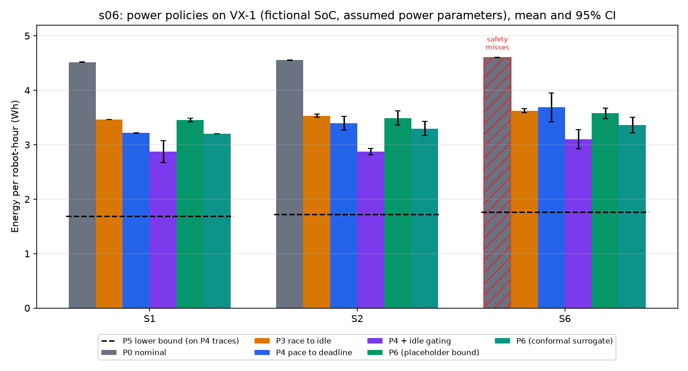

# Glass Chip

<b>For Derek Hower</b> (Performance Architect) &nbsp;|&nbsp; from Mohith Gajjela, Duke Computer Science

**What it is.** A deterministic, multi-fidelity performance and power model of a fictional physical-AI SoC (VX-1), coupled in one virtual clock to a MuJoCo robot arm picking parts off a conveyor. Every task in the robot stack (camera ingest, detection, a VLA policy, cuRobo-style planning, 1 kHz control, a safety monitor, ROS 2-style middleware) runs as jobs on the chip model, and a job's output reaches the robot only when the model says it finished. A 3D "glass" view shows NoC transfers, NPU tiles, a deadline ring per task and voltage per domain next to the arm.

**How it maps to your team's work**

- **Several models stitched per component.** Each block runs at L0 (analytic), L1 (transaction level) or L2 (Ramulator 2 and BookSim 2 in-process, SCALE-Sim tables, gem5 cycles), mixed per component by a YAML file, with cross-fidelity error and speed measured for every mix.
- **Deadlines, not speed.** Every job has a deadline; the model reports misses, an exact critical-path attribution of each miss (run queue, NoC, DRAM, DMA, preemption), and end-to-end chains, from one task alone up to a fifteen-task scenario.
- **ROS 2 and cuRobo workloads.** Graphs come from real models and code (SmolVLA, YOLOv8n, Whisper-tiny, compiled RV64 control). cuRobo and ROS 2 were fallbacks: planner graphs from cuRoboV2's algorithms checked against published timings, middleware costs measured on a Mac and scaled.
- **RISC-V and UDB.** RVV planner kernels in gem5, and one custom instruction (`xcol.sdf`, fused sphere-vs-distance-field lookup) defined in my own local UDB copy, validated with UDB's checks, implemented in gem5 and pushed through the SoC model to replan latency.

**Three findings** (VX-1 is fictional; accuracy is relative to reference simulators, not silicon)

1. **Pacing to deadlines saves energy with zero misses.** In the nominal scenario the pace-to-deadline policy runs at 3.22 Wh per robot-hour against 4.52 Wh at nominal voltage and 3.46 Wh for race-to-idle, with no deadline misses. <!-- src: results/s06.json#aggregate.S1.policies.P4.energy_per_robot_hour_wh.mean --> <!-- src: results/s06.json#aggregate.S1.policies.P0.energy_per_robot_hour_wh.mean --> <!-- src: results/s06.json#aggregate.S1.policies.P3.energy_per_robot_hour_wh.mean -->
2. **The bandwidth wall was a scheduling problem, then a thermal one.** Under FIFO a background recorder breaks robot-stack deadlines from 5.97 Gbit/s; EDF variants miss nothing up to 48 Gbit/s. At 96 Gbit/s the EDF variants throttle and every configuration misses, but mixed-criticality EDF with QoS and partitioning keeps 0 safety misses (90 others) where FIFO has 187. Attribution blames the CPU run queue for 770 missed jobs and the NoC for 244. In closed loop the safety chain's p99 rises to 62.9 ms against 37.0 ms; the arm stops later but still stops. <!-- src: results/s04.json#headline.robot_stack_first_miss_bitrate_gbps.P0 --> <!-- src: results/s04.json#points[34].bitrate_gbps --> <!-- src: results/s04.json#points[5].bitrate_gbps --> <!-- src: results/s04.json#points[35].safety_misses --> <!-- src: results/s04.json#points[35].robot_misses --> <!-- src: results/s04.json#points[5].safety_misses --> <!-- src: results/s03.json#headline.dominant_wait_overall.runqueue --> <!-- src: results/s03.json#headline.dominant_wait_overall.noc --> <!-- src: results/s16.json#part_a_safety_under_load["recording 24 Gbit/s | P0 FIFO"].human_to_slowdown_p99_ms.mean --> <!-- src: results/s16.json#part_a_safety_under_load["recording 24 Gbit/s | EDF-MC + QoS + partition"].human_to_slowdown_p99_ms.mean -->
3. **The fast model misses one target, and I know why.** L1 is off by 12.1% on mean task latency against the L2 reference (target 10%); moving only the fixed-IPC CPU model to gem5-calibrated L2 brings it to 4.1%. <!-- src: results/s10.json#analysis.acceptance.L1_mean_abs_err|pct --> <!-- src: results/s10.json#analysis.acceptance.L1_mean_target|pct --> <!-- src: results/s10.json#analysis.scenarios.L1+cpu@L2.mean.mean_abs|pct -->

<figure><figcaption>Energy per robot-hour by power policy in three scenarios (s06). Dashed line: offline lower bound. Hatched bar: safety misses.</figcaption></figure>

**Links.** Repo: [github.com/Mohith26/glass-chip](https://github.com/Mohith26/glass-chip) &nbsp;|&nbsp; Live demo: [mohith26.github.io/glass-chip](https://mohith26.github.io/glass-chip/) &nbsp;|&nbsp; Technical report: report/glass-chip-report.pdf in the repo
