# Glass Chip: a closed-loop, multi-fidelity performance and power model of a physical-AI SoC running a live robot

**Mohith Gajjela**, Duke University, Computer Science

*Technical report. Every number in this report comes from a committed results file (`results/sNN.json`) written by a committed study script against frozen core build `3e9cf32325432d0f`, and `tools/numcheck.py` checks each one against its source field. VX-1 is a fictional reference SoC; it describes no real product.*

## Abstract

Robot SoCs are judged by deadlines, not by speed. A perception job that finishes long before its deadline earns nothing except idle time, while a safety monitor that misses by a few milliseconds changes how close the arm gets to a person. I built Glass Chip to study that trade-off end to end. It couples a MuJoCo pick-from-conveyor robot to a deterministic discrete-event model of a fictional physical-AI SoC (VX-1) in one virtual clock, so chip latency becomes robot behavior. The SoC model runs each component at one of several fidelity levels (analytic, transaction-level, and cycle-approximate through Ramulator 2, BookSim 2, SCALE-Sim and gem5) and mixes them per component. Workloads are operator graphs derived from real models and code (YOLOv8n, SmolVLA, Whisper-tiny, LR-ASPP, cuRoboV2-style planning, compiled RV64 control loops). A power layer adds DVFS, leakage, a thermal network and deadline-aware policies, and a LightGBM surrogate with split-conformal intervals makes design-space exploration interactive in a browser. The main findings: pacing to deadlines runs the nominal scenario at 3.22 Wh per robot-hour against 4.52 Wh at nominal voltage with zero misses; a background recorder breaks real-time tasks first through scheduling, not bandwidth; under contention the safety chain's p99 latency rises to 62.9 ms and the arm stops later, but still stops; and the transaction-level model misses its 10% mean-latency target at 12.1%, almost entirely because of a fixed-IPC CPU model. <!-- src: results/s06.json#aggregate.S1.policies.P4.energy_per_robot_hour_wh.mean --> <!-- src: results/s06.json#aggregate.S1.policies.P0.energy_per_robot_hour_wh.mean --> <!-- src: results/s16.json#part_a_safety_under_load["recording 24 Gbit/s | P0 FIFO"].human_to_slowdown_p99_ms.mean --> <!-- src: results/s10.json#analysis.acceptance.L1_mean_target|pct --> <!-- src: results/s10.json#analysis.acceptance.L1_mean_abs_err|pct -->

## 1. Motivation

A robot controller used to be a host CPU, a GPU card and sometimes an FPGA. Physical-AI SoCs fold all of that into one low-power chip that must run perception, a vision-language-action (VLA) policy, motion planning, a 1 kHz control loop and a safety monitor at the same time. Three properties make this hard to evaluate with the usual tools.

First, the requirement is a set of deadlines under concurrency. The question is whether every task meets its deadline when many tasks share DRAM, the on-chip network and the accelerators, and which shared resource is to blame when one does not. Throughput benchmarks of one model at a time do not answer it.

Second, the chip is too big to simulate everything cycle by cycle. Performance teams build several models of different accuracy and stitch them together: detailed for the block under study, abstract elsewhere. That only works if the error of each level is measured.

Third, the consequences are physical. A late controller holds a stale torque; a late detector makes the policy act on an old object pose; a late safety monitor stops the arm late. The right metric is often a robot metric, not a latency.

Glass Chip is my attempt at a small, honest version of that methodology. It is a simulator plus a visualization: a 3D "glass" view of the die that shows transfers crossing the NoC, accelerator tiles lighting up, a deadline ring per task and voltage per power domain, next to the robot doing the work. This report covers the model, how I validated it, and what sixteen studies found.

## 2. System overview

The system has six parts that share one virtual clock and one set of configs.

```
 workloads/ (task graphs) ---> glasschip-core (C++20 DES, L0-L2) <---> power/ (V/f, thermal, P0-P6)
                                   ^               ^
                                   |               | 1 ms lockstep, one virtual clock
 calib/ + riscv/  (L2 tables ------+               v
   from gem5, Ramulator 2,                   cosim/ (MuJoCo Panda, conveyor, robot stack)
   BookSim 2, SCALE-Sim)                           |
                                                   v  replay files or WebSocket
 surrogate/ (LightGBM + conformal, ONNX) -----> viz/ (robot, 3D die, rings, timeline, DSE)
```

**The SoC.** VX-1 has an 8-core RV64 application CPU in two clusters, a lockstep in-order RT pair running from tightly coupled memory, a 4-tile 64x64 INT8 systolic NPU, a 4-unit SIMT cluster for cuRobo-style kernels, two vision DSPs, an 8 MB shared system cache, a 4x4 mesh NoC with 256-bit links, 128-bit LPDDR5X-8533 DRAM on two controllers, eight DMA engines and eight power domains. All of these are assumptions in `configs/soc/vx1.yaml`, sized so real workloads land near contention limits. <!-- numcheck: ignore (configuration inputs) -->

**The kernel.** Virtual time is an int64 count of picoseconds. Events are ordered by (time, sequence number), each component has its own PCG64 stream derived from the master seed, and components exchange only timestamped transactions. A run is a pure function of configs and seed: the trace hash is byte-identical across runs, and restoring a checkpoint and running forward reproduces the original hash. Both are unit tests.

**Attribution.** Every completed job carries an exact split of its response time into compute, run-queue wait, engine-queue wait, NoC, DRAM, cache, DMA, preemption, DVFS and middleware, plus its critical path. I walk back from the final op through the predecessor that set each op's ready time and assign every interval on that path to one category, so the categories sum to the response time. This is what the "Why did this miss?" button in the viewer animates.

**The runtime model.** Jobs are released with absolute deadlines. Each op is mapped to an engine when its inputs are ready (static affinity or greedy earliest-finish-time). Engines run FIFO, fixed-priority (rate monotonic), EDF, or mixed-criticality EDF where best-effort work never preempts safety work. CPUs preempt at step boundaries and pay a context switch; the NPU preempts only at layer boundaries and pays a save and restore. A ROS 2 executor model adds a receive op and a publish op to each job, with copy or zero-copy transport.

## 3. Multi-fidelity design

Each component implements some of four levels, and a fidelity mix (a YAML file) picks one per component.

| Level | Idea | Components |
|---|---|---|
| L0 analytic | roofline per op; M/D/1 waits on the busiest link or channel; traffic added as fluid load | all |
| L1 transaction | link reservation calendars with VC flow control and round-robin tail delay; set-associative cache with way partitioning; bank-level DRAM with FR-FCFS, refresh and turnaround; closed-form systolic tiles with SRAM tiling, double buffering and compiler fusion | all |
| L2 cycle-approximate | Ramulator 2 and BookSim 2 in-process as plugins, synchronized every 100 ns quantum; SCALE-Sim cycle tables per NPU op; gem5 cycles per call for the real CPU kernels | DRAM, NoC, NPU, CPU |
| L3 reference | gem5 RISC-V O3 and Minor runs of the compiled kernels, offline | CPU |

The named mixes are `interactive` (CPU, SIMT and DSP at L0; NPU, NoC, DRAM and cache at L1), `study` (everything at L1 with NPU and CPU tables at L2), `analytic`, `memory_focus` and `reference`. An unavailable level falls back to the next lower one and the simulator reports why. Section 6 measures what each mix costs in accuracy and speed.

Two modeling choices matter for the results. The NPU model includes a compiler pass that fuses attention (QK^T, softmax, AV) into one flash-attention style loop and lets elementwise ops consume their producer's output on chip. And the NoC model reflects the floorplan: each node has one injection and one ejection port, so the two DRAM controller nodes cap DRAM traffic below the DRAM peak. BookSim shows the same cap.

## 4. Workloads and their provenance

Every task is a JSON operator graph validated against a schema, and each records where it came from: script, model name and version, hash, date and method. Periods and deadlines are reasonable defaults for a pick-from-conveyor task, not measured requirements.

| Task | Source | Method | Deadline (ms) |
|---|---|---|---|
| T1 camera ingest (x2) | ISP-style preprocessing, per-pixel op counts | analytic count | 15 <!-- src: results/s01.json#alone.T1_ingest_wrist.deadline_ms --> |
| T2 detection | YOLOv8n exported to ONNX at 640x640, walked op by op; NMS and pose refinement counted | mixed | 33 <!-- src: results/s01.json#alone.T2_detect.deadline_ms --> |
| T3 ESDF update | cuRoboV2 TSDF/ESDF algorithms and defaults, op counts | analytic, checked against published timings | 66 <!-- src: results/s01.json#alone.T3_esdf.deadline_ms --> |
| T4 VLA | SmolVLA: real SmolVLM2 vision graph walked per camera; LM prefill and flow-matching expert derived from config and source | mixed | 100 <!-- src: results/s01.json#alone.T4_vla.deadline_ms --> |
| T5 planning | cuRoboV2 IK, TrajOpt, TimeOpt; one op per kernel launch | analytic, checked against published timings | 50 <!-- src: results/s01.json#alone.T5_plan.deadline_ms --> |
| T6 estimation | C++ Kalman filter and tracker, gem5 dynamic instruction counts | compiled RV64 | 5 |
| T7 control | C++ Panda impedance control with RNEA, gem5 counts | compiled RV64 | 1 |
| T8 safety | LR-ASPP MobileNetV3 at 320x240 plus compiled speed-and-separation monitoring | mixed | 10 <!-- src: results/s01.json#alone.T8_safety.deadline_ms --> |
| T10 recording | DMA and DRAM streams scaled by bitrate | analytic count | best effort |
| T11-T15 (S6) | Whisper-tiny speech, second arm control, map save, OTA, diagnostics | mixed and analytic | per task |

For T4, every parameter group I derived matches the real `model.safetensors` header, which I read with an HTTP range request without downloading the weights. Weights do not change the operator graph, so the vision encoder is exported with random weights.

Two parts are fallbacks, and I want to be plain about them. I had no GPU, so I did not profile cuRoboV2; T3 and T5 come from kernel FLOP and byte counts read off cuRoboV2's algorithms, its Franka sphere model and its optimizer defaults, then compared with its published RTX and Jetson timings. There was no ROS 2 install, so I wrote a CDR serializer for the stack's real message layouts, measured it on a Mac, and scaled the costs to the target by an assumed factor; executor dispatch comes from a published ROS 2 executor study. These middleware costs were measured on a Mac and scaled, not measured on a robot SoC.

## 5. Closed-loop co-simulation

Physics is MuJoCo at 1 ms steps with a Franka Panda under joint-torque control, a belt with pooled objects, two cameras and a walking human proxy. At every step the bridge releases due jobs with their inputs snapshotted at release, advances the chip model to the same virtual time, applies finished jobs in completion order (and releases chained jobs such as detection after ingest), then sends the latest finished control command to the motors.

The stale-data rules make timing visible. A late T7 leaves the previous torque on the motors. A late T2 means tracking and the policy keep the previous detection. A late T8 slows or stops the arm late. I track two end-to-end chains with tags that travel with the data: camera frame to the first actuator command from the resulting plan, and human detection to the first command that uses the resulting safety decision.

**Hybrid mode.** I could not run an open VLA closed loop at a useful rate on a laptop. The arm's behavior therefore comes from a scripted expert (track the object, predict the intercept, plan, grasp), while the VLA's compute is modeled from SmolVLA's real operator graph as task T4 on the chip. The policy sits behind a small interface so a learned policy can replace it.

**Disturbances.** Without disturbances, a policy that compensates for latency barely notices latency. The belt therefore has a speed ripple and each object slips, both Ornstein-Uhlenbeck processes with assumed parameters, and study s14 includes a sensitivity sweep over them.

## 6. Validation and calibration

Accuracy here means agreement with reference simulators, not with silicon.

**Reference tools.** I built Ramulator 2 (DRAM), BookSim 2 (NoC), SCALE-Sim (one 64x64 systolic tile) and gem5 (RV64 O3 and Minor cores) on an Apple Silicon Mac. Each needed fixes, which are documented in `calib/README.md`; for example, BookSim had no trace input, so I added a trace mode, and its cross-check against the native hotspot run caught a config syntax trap that had silently created a single hotspot.

**Cross-fidelity (s10).** I ran 26 microbenchmark cases and scenarios S1-S8 at every level and computed the absolute relative error of each task's mean and p99 response against a reference that puts the NPU and CPU at L2 (tier A). <!-- src: results/s10.json#analysis.microbench.L1.stats.n -->

| Acceptance target | Measured | Result |
|---|---|---|
| L1 within 10% of L2 on task means | 12.1% | missed <!-- src: results/s10.json#analysis.acceptance.L1_mean_target|pct --> <!-- src: results/s10.json#analysis.acceptance.L1_mean_abs_err|pct --> |
| L1 within 20% on p99 | 14.8% | met <!-- src: results/s10.json#analysis.acceptance.L1_p99_target|pct --> <!-- src: results/s10.json#analysis.acceptance.L1_p99_abs_err|pct --> |
| L0 within 30% on means | 24.6% | met <!-- src: results/s10.json#analysis.acceptance.L0_mean_target|pct --> <!-- src: results/s10.json#analysis.acceptance.L0_mean_abs_err|pct --> |

The L1 miss is the CPU. Moving only the CPU to L2 cuts the L1 mean error to 4.1%, while moving only the NPU gives 11.2%. L1 assumes fixed IPC per core class, and gem5 disagrees in both directions: L1 is 94.8% too slow on the app-core control step and 53.6% too fast on the estimator (a signed error of -53.6%). Dropping the NoC to L0 costs the most of any single component, 22.2% mean error. <!-- src: results/s10.json#analysis.scenarios.L1+cpu@L2.mean.mean_abs|pct --> <!-- src: results/s10.json#analysis.scenarios.L1+npu@L2.mean.mean_abs|pct --> <!-- src: results/s10.json#cpu_vs_gem5.cases.control_step_cpu.levels.L1.rel_err_vs_gem5|pct --> <!-- src: results/s10.json#cpu_vs_gem5.cases.estimate_step_cpu.levels.L1.rel_err_vs_gem5|pct --> <!-- src: results/s10.json#cpu_vs_gem5.cases.estimate_step_cpu.levels.L1.rel_err_vs_gem5|scale=-100 --> <!-- src: results/s10.json#analysis.scenarios.L1+noc@L0.mean.mean_abs|pct -->

<figure>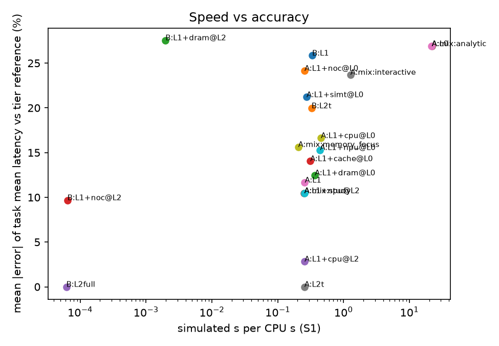<figcaption>Figure 1 (s10). Mean task-latency error against the tier reference versus simulation speed on S1 (simulated seconds per CPU second). Tier A points use the L2-table reference; tier B points run Ramulator 2 and BookSim 2 in the loop.</figcaption></figure>

| Mix | Mean error | p99 error | Simulated s per CPU s |
|---|---|---|---|
| analytic | 24.6% | 52.3% | 25.9 <!-- src: results/s10.json#analysis.scenarios["mix:analytic"].mean.mean_abs|pct --> <!-- src: results/s10.json#analysis.scenarios["mix:analytic"].p99.mean_abs|pct --> <!-- src: results/s10.json#speed["A:mix:analytic"].sim_s_per_cpu_s --> |
| interactive | 20.4% | 28.4% | 0.862 <!-- src: results/s10.json#analysis.scenarios["mix:interactive"].mean.mean_abs|pct --> <!-- src: results/s10.json#analysis.scenarios["mix:interactive"].p99.mean_abs|pct --> <!-- src: results/s10.json#speed["A:mix:interactive"].sim_s_per_cpu_s --> |
| memory_focus | 15.6% | 24.0% | 0.0803 <!-- src: results/s10.json#analysis.scenarios["mix:memory_focus"].mean.mean_abs|pct --> <!-- src: results/s10.json#analysis.scenarios["mix:memory_focus"].p99.mean_abs|pct --> <!-- src: results/s10.json#speed["A:mix:memory_focus"].sim_s_per_cpu_s --> |
| study | 11.2% | 12.7% | 0.114 <!-- src: results/s10.json#analysis.scenarios["mix:study"].mean.mean_abs|pct --> <!-- src: results/s10.json#analysis.scenarios["mix:study"].p99.mean_abs|pct --> <!-- src: results/s10.json#speed["A:mix:study"].sim_s_per_cpu_s --> |

**External simulators in the loop (tier B).** With Ramulator 2 and BookSim 2 running inside the core, a simulated second costs thousands of CPU seconds, so tier B covers only the first 40 ms of S1. There, L1 is off by 13.5% on task means against full L2. I read that as a spot check, not a scenario-wide number. <!-- src: results/s10.json#setup.tier_b_s1_window_s|scale=1000 --> <!-- src: results/s10.json#analysis_tier_b.acceptance.L1_mean_abs_err|pct -->

**Per-request replay.** I exported the core's own DRAM and NoC request traces and replayed them open loop through Ramulator 2 and BookSim 2. Averaged over six cases, the NoC mean error is 12.7% and the NoC p99 error 4.2%; DRAM is worse at 35.0% on the mean, mostly because open-loop replay floods Ramulator with whole 4 KB chunks at once. The all-to-one hotspot is the NoC's weak case: its mean is 38.0% pessimistic even though its p99 is within 2.4%. <!-- src: results/s10.json#trace_replay.summary["study_L1/noc"].mean_abs_rel_err_of_mean|pct --> <!-- src: results/s10.json#trace_replay.summary["study_L1/noc"].mean_abs_rel_err_of_p99|pct --> <!-- src: results/s10.json#trace_replay.summary["study_L1/dram"].mean_abs_rel_err_of_mean|pct --> <!-- src: results/s10.json#trace_replay.cases["all_to_one_hotspot_6x4MB/study_L1"].noc.rel_err_mean|pct --> <!-- src: results/s10.json#trace_replay.cases["all_to_one_hotspot_6x4MB/study_L1"].noc.rel_err_p99|pct -->

**NPU against SCALE-Sim (s15).** Over the conv and matmul ops of the five NPU tasks, the closed-form systolic model differs from SCALE-Sim by a median of 26.2% per op. The cause is a modeling choice: I hide each weight-tile load behind streaming, while SCALE-Sim's weight-stationary mode charges it on every fold. With overlap turned off, the median per-op error is 0.42%. <!-- src: results/s15.json#npu_vs_scalesim.overall.per_op_abs_rel_err_median|pct --> <!-- src: results/s15.json#npu_vs_scalesim.overall.no_weight_load_overlap_diagnostic.per_op_abs_rel_err_median|pct -->

**External sanity check (s15).** The target here is agreement within 30% of the public number. <!-- numcheck: ignore (target is an input) -->
I configured an Orin-like SoC from public Jetson AGX Orin specifications and ran three MLPerf Edge models against NVIDIA's published single-stream latencies, fixing the mapping before looking at any result. RetinaNet lands at -7.5% and BERT-Large at +4.7%, inside the target; ResNet-50 misses at -43.1%, probably because the model leaves out per-kernel launch and synchronization overhead at batch 1 (an untested guess). This is a sanity check of the approach, not validation of any hardware. <!-- src: results/s15.json#orin_sanity.models.T91_retinanet.runs["gpu_wide_primary/study"].rel_err|pct --> <!-- src: results/s15.json#orin_sanity.models.T92_bert_large.runs["gpu_wide_primary/study"].rel_err|pct --> <!-- src: results/s15.json#orin_sanity.models.T90_resnet50.runs["gpu_wide_primary/study"].rel_err|pct -->

**Robot side (s14).** With the chip replaced by a fixed injected latency, grasp success falls monotonically with latency within noise at every conveyor speed, which is the sanity check the co-simulation needs before chip latency can be trusted to mean anything.

## 7. Studies

Unless noted, studies use the interactive mix, chip-only runs for pure chip questions and full co-simulation where robot behavior matters, and report means with 95% intervals over seeds. <!-- numcheck: ignore (interval level is a format constant) -->

### 7.1 Baseline and concurrency (s01, s02, s05)

Alone on an idle SoC, the VLA's p99 response is 54.4 ms against its 100 ms deadline; inside S1 with everything else running it is 56.9 ms. S1 misses no deadlines, averages 4.51 W, uses 12.7 GB/s of DRAM and keeps the NPU 44.8% busy. The median camera-to-grasp chain is 96.5 ms, most of it sampling waits between periodic tasks rather than compute. <!-- src: results/s01.json#headline.vla_alone_p99_ms --> <!-- src: results/s01.json#alone.T4_vla.deadline_ms --> <!-- src: results/s01.json#headline.vla_s1_p99_ms --> <!-- src: results/s01.json#headline.s1_avg_power_w --> <!-- src: results/s01.json#headline.s1_dram_gbps --> <!-- src: results/s01.json#headline.s1_npu_utilization|pct --> <!-- src: results/s01.json#headline.s1_camera_to_grasp_p50_ms -->

Adding tasks one at a time up to the fifteen-task S6 produced no misses under FIFO or EDF at nominal voltage; the VLA's p99 grows to 65.3 ms under FIFO and 73.9 ms under EDF, which deprioritizes it behind shorter-deadline work. The second camera (S2) also caused no misses. On this configuration, concurrency alone is not the problem; a bandwidth hog plus the wrong scheduler is. <!-- src: results/s02.json#headline.full_s6_vla_p99_ms.P0 --> <!-- src: results/s02.json#headline.full_s6_vla_p99_ms.P2 -->

Scheduling policy matters once there is a hog. In S7 (4K recording), FIFO misses 29.4 jobs per second including 277 safety misses (figures in `results/figures/s02_concurrency.png` and `s05_scheduling.png`), while rate-monotonic fixed priority misses 7.8 per second with no safety misses and EDF misses 7.7 per second with one. <!-- src: results/s05.json#headline["S7 / P0 FIFO"].misses_per_s --> <!-- src: results/s05.json#headline["S7 / P0 FIFO"].safety_misses --> <!-- src: results/s05.json#headline["S7 / P1 fixed priority"].misses_per_s --> <!-- src: results/s05.json#headline["S7 / P2 EDF"].misses_per_s -->
### 7.2 The bandwidth wall and its root cause (s03, s04)

I swept the recording bitrate from 1 to 96 Gbit/s under six configurations. Under FIFO, robot-stack misses start at 5.97 Gbit/s, which is raw 4K30, and the VLA starts missing at 48 Gbit/s. QoS plus cache partitioning on top of FIFO makes the VLA miss earlier, at 24 Gbit/s. EDF and mixed-criticality EDF, with or without QoS and partitioning, have no misses at any bitrate up to 48 Gbit/s. <!-- src: results/s04.json#points[0].bitrate_gbps --> <!-- src: results/s04.json#points[5].bitrate_gbps --> <!-- src: results/s04.json#headline.robot_stack_first_miss_bitrate_gbps.P0 --> <!-- src: results/s04.json#headline.vla_first_miss_bitrate_gbps.P0 --> <!-- src: results/s04.json#headline.vla_first_miss_bitrate_gbps["P0+QoS+part"] --> <!-- src: results/s04.json#points[34].bitrate_gbps --> <!-- src: results/s04.json#points[34].robot_misses -->
At 96 Gbit/s the limit changes from scheduling to heat. The module draws about 9.75 W there, more than twice the 4.51 W of S1, and the EDF variants now run into thermal throttling, so every configuration misses: FIFO has 976 robot-stack misses including 187 safety misses, EDF has 679 with 123 safety, and mixed-criticality EDF with QoS and partitioning has 90 with no safety misses. A criticality-aware scheduler still protects the safety tasks once the chip throttles; it cannot protect everything. <!-- src: results/s04.json#points[35].avg_power_w.mean --> <!-- src: results/s01.json#headline.s1_avg_power_w --> <!-- src: results/s04.json#points[5].robot_misses --> <!-- src: results/s04.json#points[5].safety_misses --> <!-- src: results/s04.json#points[17].robot_misses --> <!-- src: results/s04.json#points[17].safety_misses --> <!-- src: results/s04.json#points[35].robot_misses --> <!-- src: results/s04.json#points[35].safety_misses -->

The attribution study explains why. Across the 943 missed jobs in S7 and the 75 in S8, the largest non-compute component was the CPU run queue for 770 jobs and the NoC for 244. In S7 every robot task's dominant wait is the run queue; only the recorder itself is NoC-bound. The recorder is not only a DMA stream: it also runs a chunk-index and CRC kernel on the application cores whose cost grows with the bitrate. Under FIFO, state estimation, detection and the safety monitor's CPU stages queue behind that kernel. That is why QoS on the memory system does not fix FIFO and a criticality-aware scheduler does. <!-- src: results/s03.json#headline.missed_jobs_by_case.S7_P0 --> <!-- src: results/s03.json#headline.missed_jobs_by_case.S8_P0 --> <!-- src: results/s03.json#headline.dominant_wait_overall.runqueue --> <!-- src: results/s03.json#headline.dominant_wait_overall.noc -->

<figure>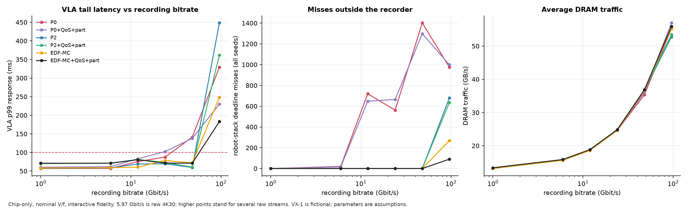<figcaption>Figure 2 (s04). VLA p99, robot-stack misses and DRAM traffic versus recording bitrate for six scheduler and memory-QoS configurations.</figcaption></figure>

### 7.3 Middleware tax (s09)

Zero-copy transport cuts DRAM traffic by 3.4% in S1 and moves the median camera-to-detection chain from 6 ms to 5 ms. The chain is measured at 1 ms physics steps, so that difference is one step. Middleware is a small tax on this stack; the copies are not where the time goes. <!-- src: results/s09.json#headline.S1.dram_saving_frac|pct --> <!-- src: results/s09.json#headline.S1.camera_to_detection_p50_ms.copy --> <!-- src: results/s09.json#headline.S1.camera_to_detection_p50_ms.zero_copy -->

## 8. Power and thermal

**Model.** Frequency follows the alpha-power law, f(V) = k (V - Vth)^alpha / V, fitted so each domain hits its nominal clock at nominal voltage. Dynamic energy is activity times C_eff V^2 per operation class (INT8 and BF16 MACs, SRAM and cache bytes, NoC flit-hops, DRAM bytes, CPU instructions), seeded from published 7 nm per-operation energy tables and scaled to a generic 5 nm class node. Leakage is V I0 exp(cT (T - T0)). A regulator efficiency curve, DVFS transition stalls and costs, power gating with retention and wake latency, and a lumped RC thermal network with throttling hysteresis complete the layer. Every parameter is an assumption, and energy numbers are only comparable within this model.

**Policies.** P0 runs at nominal voltage, P1 and P2 change only the scheduler, P3 races to idle and power-gates, P4 paces each domain to the lowest operating point predicted to meet every pending deadline, P5 is an offline minimum-energy bound solved as a MILP with HiGHS on the recorded job trace, and P6 is P4 with a conformal surrogate's upper bound on finish time. P4 keeps the NoC at nominal: when I let a governor lower the NoC clock, every task's memory time stretched and the VLA missed every deadline.

### 8.1 Energy per robot-hour (s06)

| S1, five seeds | Energy per robot-hour | Deadline misses |
|---|---|---|
| P0 nominal | 4.52 Wh | 0 <!-- src: results/s06.json#aggregate.S1.policies.P0.energy_per_robot_hour_wh.mean --> |
| P3 race to idle | 3.46 Wh | 0 <!-- src: results/s06.json#aggregate.S1.policies.P3.energy_per_robot_hour_wh.mean --> |
| P4 pace to deadline | 3.22 Wh | 0 <!-- src: results/s06.json#aggregate.S1.policies.P4.energy_per_robot_hour_wh.mean --> |
| P4 plus idle gating (extra variant) | 2.88 Wh | 0 <!-- src: results/s06.json#aggregate.S1.policies.P4G.energy_per_robot_hour_wh.mean --> |
| P6 conformal surrogate | 3.20 Wh | 2 <!-- src: results/s06.json#aggregate.S1.policies.P6.energy_per_robot_hour_wh.mean --> <!-- src: results/s06.json#aggregate.S1.policies.P6.misses_total --> |
| P5 lower bound (on P4 traces) | 1.69 Wh | n/a <!-- src: results/s06.json#aggregate.S1.policies.P4.p5_bound_wh.mean --> |

Pacing beats racing on the busy domains and racing wins on idle ones, which is why combining them (P4G) is lowest. The P4 margins were tuned on S1 pilot runs, so I also ran five held-out seeds that never touched tuning: P4 gives 3.21 Wh with zero misses. P6's two misses are non-safety. The gap to the P5 bound is large partly because the bound relaxes many real costs (independent domains, perfect packing, no transition or wake costs, leakage at ambient). <!-- src: results/s06.json#held_out.aggregate.S1.policies.P4.energy_per_robot_hour_wh.mean -->

Under fifteen concurrent tasks (S6) the picture is less clean. P0 has 4 safety misses there in co-simulation, P3 has none at 3.63 Wh, and P4 has 26 non-safety misses at 3.69 Wh. Pacing on a crowded chip needs more margin than I gave it. <!-- src: results/s06.json#aggregate.S6.policies.P0.safety_misses --> <!-- src: results/s06.json#aggregate.S6.policies.P3.energy_per_robot_hour_wh.mean --> <!-- src: results/s06.json#aggregate.S6.policies.P4.misses_total --> <!-- src: results/s06.json#aggregate.S6.policies.P4.energy_per_robot_hour_wh.mean -->

<figure>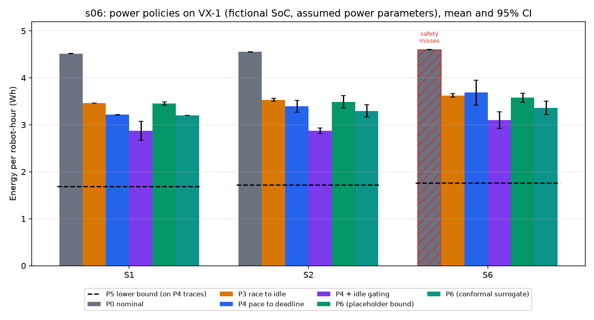<figcaption>Figure 3 (s06). Energy per robot-hour by policy and scenario with 95% intervals; the dashed line is the P5 lower bound. VX-1 is fictional and all power parameters are assumptions.</figcaption></figure> <!-- numcheck: ignore (caption format) -->

### 8.2 The voltage cliff (s07)

I swept a static minimum voltage per domain under P0 (pinned) and used the same value as a floor for P4. The NPU's static cliff is sharp: clean at 0.55 V, and at 0.50 V the VLA misses 99.4% of its jobs. P4 with its floor at 0.40 V has zero misses while spending 32.6% of the time below the static cliff voltage, because it only drops voltage when the slack is there. The CPU domain's static cliff starts at 0.50 V and the RT domain's at 0.32 V. The model has no timing-error physics, so this cliff is deadline-driven (the clock is too slow), not a logic-failure cliff, and points below the configured table are extrapolated. <!-- src: results/s07.json#aggregate.npu.cliff.static_lowest_clean_v --> <!-- src: results/s07.json#aggregate.npu.cliff.static_cliff_first_miss_v --> <!-- src: results/s07.json#aggregate.npu.cliff.static_cliff_1pct_tasks.T4_vla|pct --> <!-- src: results/s07.json#aggregate.npu.series.P4[2].vmin --> <!-- src: results/s07.json#aggregate.npu.cliff.p4_time_fraction_below_static_cliff_first_miss|pct --> <!-- src: results/s07.json#aggregate.cpu.cliff.static_cliff_first_miss_v --> <!-- src: results/s07.json#aggregate.rt.cliff.static_cliff_first_miss_v -->

A low-voltage arithmetic factor, standing for the class of low-voltage arithmetic techniques that vendors have described publicly, scales MAC energy. I label every non-default setting hypothetical and do not claim it represents anyone's technology.

<figure>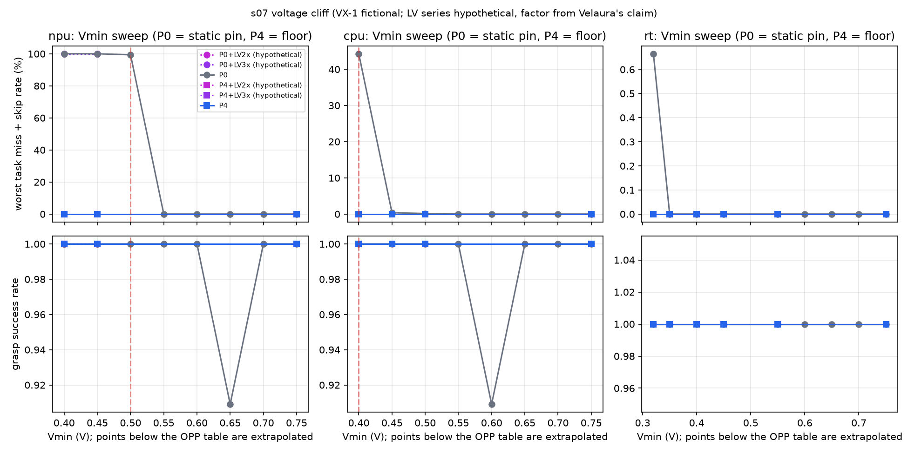<figcaption>Figure 4 (s07). Worst-task miss rate and grasp success versus Vmin per domain. P0 pins the voltage, P4 treats it as a floor. LV series are hypothetical.</figcaption></figure>

### 8.3 Thermal (s08)

The enclosure is sized by a design rule (the nominal operating point keeps the hottest junction at 85 C at 40 C ambient). With leakage feedback, P0's steady state stops existing between 42.5 C and 45 C ambient: above that, only throttling keeps it finite. In the S5 hot-day ramp, throttling under P0 starts 53.5 s into the run, the junction peaks at 106.1 C, and two jobs miss after onset with no safety misses. P4 never throttles and peaks at 90.5 C, because it was already drawing less power. <!-- src: results/s08.json#steady_state_and_onset_time[0].throttle_onset_ambient.between_c[0] --> <!-- src: results/s08.json#steady_state_and_onset_time[0].throttle_onset_ambient.between_c[1] --> <!-- src: results/s08.json#s5_closed_loop.P0.onset_s_mean --> <!-- src: results/s08.json#s5_closed_loop.P0.peak_temp_c_max --> <!-- src: results/s08.json#s5_closed_loop.P0.misses_after_onset --> <!-- src: results/s08.json#s5_closed_loop.P4.peak_temp_c_max -->

**A thermal-design finding.** At 45 C ambient the assumed sealed, fanless enclosure has no thermal steady state at the nominal operating point, and throttling does not restore one: in the fast-conveyor runs at 45 C (Section 9) the module stayed throttled for 59.0 of 60 s. VX-1's enclosure parameters are assumptions sized by the 40 C design rule above, so the honest reading is that this enclosure is undersized for a 45 C site, not that any policy fails. A real design would need more conduction to ambient, a fan, or a derated ambient spec. <!-- src: results/s08.json#steady_state_and_onset_time[0].steady_state[6].ambient_c --> <!-- src: results/s16.json#part_b_fast_conveyor["hot module (45 C)"].time_throttled_s.mean --> <!-- src: results/s16.json#provenance.duration_part_b_s -->

## 9. What the robot feels (s14, s16)

**Latency tolerance (s14).** With a fixed injected camera-to-grasp latency, the scripted stack tolerates 400 ms at the two slowest conveyor speeds (the largest value tested), 250 ms at the third, and only 50 ms at the fastest before grasp success drops below its tolerance threshold. That curve is the requirement the chip must meet, and it shrinks with conveyor speed. <!-- src: results/s14.json#summary.grasp_tolerance_ms["0.1"] --> <!-- src: results/s14.json#summary.grasp_tolerance_ms["0.3"] --> <!-- src: results/s14.json#summary.grasp_tolerance_ms["0.4"] -->
The tolerance is the largest swept latency before success first drops below 0.9 times the zero-latency baseline (`results/s14.json`, `definitions`). <!-- numcheck: ignore (definition) -->

<figure>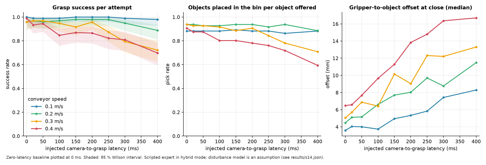<figcaption>Figure 5 (s14). Grasp success, pick rate and gripper offset versus injected latency per conveyor speed. Scripted expert in hybrid mode; the disturbance model is an assumption.</figcaption></figure>

**Safety under load (s16, part A).** A person walks into the protective zone while the recorder runs. With FIFO at 24 Gbit/s, the safety monitor misses 17.4% of its deadlines, all dominated by run-queue waits; the human-to-slowdown chain p99 rises to 62.9 ms against 37.0 ms with EDF-MC, QoS and partitioning (which has no T8 misses). Mean stop latency rises from 25.8 ms to 32.2 ms and the minimum separation while the arm was moving drops from 0.39 m to 0.35 m. The controller's worst response was 0.046 ms and there were no oscillation episodes. <!-- src: results/s04.json#points[3].bitrate_gbps --> <!-- src: results/s16.json#part_a_safety_under_load["recording 24 Gbit/s | P0 FIFO"].t8_miss_rate|pct --> <!-- src: results/s16.json#part_a_safety_under_load["recording 24 Gbit/s | P0 FIFO"].human_to_slowdown_p99_ms.mean --> <!-- src: results/s16.json#part_a_safety_under_load["recording 24 Gbit/s | EDF-MC + QoS + partition"].human_to_slowdown_p99_ms.mean --> <!-- src: results/s16.json#headline.stop_latency_ms_mean["recording 24 Gbit/s | EDF-MC + QoS + partition"] --> <!-- src: results/s16.json#headline.stop_latency_ms_mean["recording 24 Gbit/s | P0 FIFO"] --> <!-- src: results/s16.json#headline.min_separation_while_moving_m["recording 24 Gbit/s | EDF-MC + QoS + partition"] --> <!-- src: results/s16.json#headline.min_separation_while_moving_m["recording 24 Gbit/s | P0 FIFO"] --> <!-- src: results/s16.json#headline.t7_max_response_ms -->

**Fast conveyor (s16, part B).** At the fastest conveyor speed over eight runs per case, the nominal chip gives a grasp success rate of 0.95 and a pick rate of 0.79. A static NPU floor of 0.55 V costs nothing visible (0.96 grasp success) even though the VLA misses 12.1% of its deadlines, because the scripted expert tolerates stale policy outputs. At 0.50 V, grasp success falls to 0.86, pick rate to 0.65, and the median camera-to-grasp chain grows from 93.9 ms to 170.9 ms. A hot module (45 C ambient) is worse: the chip throttles for almost the whole run, the VLA misses 96.3% of its deadlines, grasp success falls to 0.85, pick rate to 0.61, and the median camera-to-grasp chain grows to 193.6 ms. <!-- src: results/s16.json#part_b_fast_conveyor.nominal.runs --> <!-- src: results/s07.json#aggregate.npu.cliff.static_lowest_clean_v --> <!-- src: results/s07.json#aggregate.npu.cliff.static_cliff_first_miss_v --> <!-- src: results/s08.json#steady_state_and_onset_time[0].steady_state[6].ambient_c --> <!-- src: results/s16.json#part_b_fast_conveyor.nominal.grasp_success_rate --> <!-- src: results/s16.json#part_b_fast_conveyor.nominal.pick_rate --> <!-- src: results/s16.json#part_b_fast_conveyor["NPU Vmin 0.55 V"].grasp_success_rate --> <!-- src: results/s16.json#part_b_fast_conveyor["NPU Vmin 0.55 V"].vla_miss_rate|pct --> <!-- src: results/s16.json#part_b_fast_conveyor["NPU Vmin 0.50 V"].grasp_success_rate --> <!-- src: results/s16.json#part_b_fast_conveyor["NPU Vmin 0.50 V"].pick_rate --> <!-- src: results/s16.json#part_b_fast_conveyor.nominal.camera_to_grasp_p50_ms.mean --> <!-- src: results/s16.json#part_b_fast_conveyor["NPU Vmin 0.50 V"].camera_to_grasp_p50_ms.mean --> <!-- src: results/s16.json#part_b_fast_conveyor["hot module (45 C)"].vla_miss_rate|pct --> <!-- src: results/s16.json#part_b_fast_conveyor["hot module (45 C)"].grasp_success_rate --> <!-- src: results/s16.json#part_b_fast_conveyor["hot module (45 C)"].pick_rate --> <!-- src: results/s16.json#part_b_fast_conveyor["hot module (45 C)"].camera_to_grasp_p50_ms.mean -->

The honest summary is that the closed-loop consequences of contention are real but moderate: it delays stops and lowers pick rate, and in these runs it never prevented a stop or destabilized the controller. Heat at 45 C is the largest robot-level effect I measured.

<figure>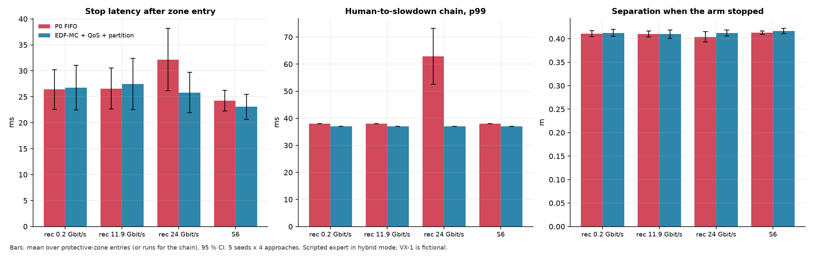<figcaption>Figure 6 (s16, part A). Stop latency after zone entry, human-to-slowdown p99 and separation when the arm stopped, FIFO versus EDF-MC with QoS and partitioning, under recording load and in S6.</figcaption></figure>

<figure>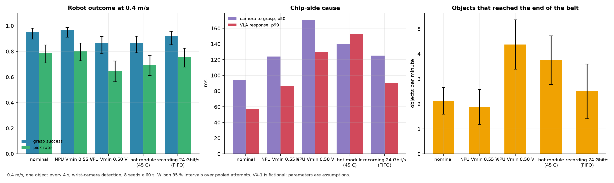<figcaption>Figure 7 (s16, part B). Robot outcome, chip-side cause and objects lost on the fast conveyor under NPU voltage floors, heat and recording.</figcaption></figure>

## 10. Surrogate and design-space exploration (s11, s12)

**Dataset.** I sampled 20 knobs (NPU tiles and array size, SRAM, cache size and partitioning, QoS, NoC width, DRAM bandwidth, CPU cores, scheduler, power policy, per-domain Vmin, the hypothetical arithmetic factor, transport, workload, recording bitrate, ambient) and ran 3,600 designs through the full chip model: 3,000 by Latin hypercube and 600 by active learning near deadline boundaries, with no failures, 4.8 CPU-hours in total. <!-- src: results/s11.json#dataset.n_inputs --> <!-- src: results/s11.json#dataset.n_total --> <!-- src: results/s11.json#dataset.n_lhs --> <!-- src: results/s11.json#dataset.n_active_learning --> <!-- src: results/s11.json#dataset.total_cpu_hours -->

**Models.** Per output I fit LightGBM and a small MLP and keep the better one on validation error (LightGBM won 60 of 63). Latencies are modeled in log space. Latency tails use conformalized quantile regression; everything else uses split conformal prediction on absolute residuals. The Latin hypercube samples are split into train, validation, calibration and test; active-learning samples are used only for training because they are not drawn from the same distribution. <!-- src: results/s11.json#summary.n_chosen_lgb --> <!-- src: results/s11.json#speed.n_outputs_python -->

**What the intervals guarantee.** If a new design is exchangeable with the calibration designs (drawn the same way and simulated by the same model and build), then the probability that its true value lies inside the 90% interval is at least 90%, where the probability is over both the new design and the calibration draw. That is marginal coverage, one output at a time. It is not coverage for a particular design, not a joint guarantee across outputs, and it says nothing outside the sampled ranges, for another fidelity mix, a different core build or closed-loop runs. <!-- src: results/s11.json#summary.nominal|pct -->

**What I measured.** On 450 held-out test designs, empirical coverage per output ranges from 0.868 to 0.933 with a median of 0.902 over 61 non-constant outputs; all 61 fall inside a band that accounts for both test sampling and the calibration draw. Over repeated re-splits, mean coverage across outputs is 0.901, which is the quantity the theory controls. Energy per robot-hour has a test mean absolute error of 0.18 Wh. I also measured two shifts on purpose: against the study mix the intervals cover 80 to 92.5% of 40 held-out designs, and inside closed-loop co-simulation runs 86 to 96%; neither is covered by the guarantee. <!-- src: results/s11.json#dataset.split_sizes.test --> <!-- src: results/s11.json#summary.coverage_min --> <!-- src: results/s11.json#summary.coverage_max --> <!-- src: results/s11.json#summary.coverage_median --> <!-- src: results/s11.json#summary.n_outputs --> <!-- src: results/s11.json#summary.n_inside_theory_band --> <!-- src: results/s11.json#summary.resplit.mean_of_means --> <!-- src: results/s11.json#headline.energy_per_robot_hour_wh.test_mae --> <!-- src: results/s11.json#fidelity_check.per_output["T8_safety.p99_ms"].surrogate_coverage_of_study_truth_90|pct --> <!-- src: results/s11.json#fidelity_check.per_output["T2_detect.p99_ms"].surrogate_coverage_of_study_truth_90|pct --> <!-- src: results/s11.json#fidelity_check.n_designs --> <!-- src: results/s11.json#cosim_shift["energy_per_robot_hour_wh"].coverage_90|pct --> <!-- src: results/s11.json#cosim_shift["T2_detect.p99_ms"].coverage_90|pct -->

The surrogate also knows when not to answer. When an interval is too wide relative to the deadline, the viewer marks it "uncertain, run full model".
The threshold is half the task's deadline for latencies and 0.05 for miss rates. <!-- numcheck: ignore (thresholds are inputs) -->
The camera-to-plan chain is bimodal and is flagged for every test design; the VLA's p99 is flagged for 61% of them. <!-- src: results/s11.json#headline["T4_vla.p99_ms"].frac_uncertain_90|pct -->

<figure class="pair">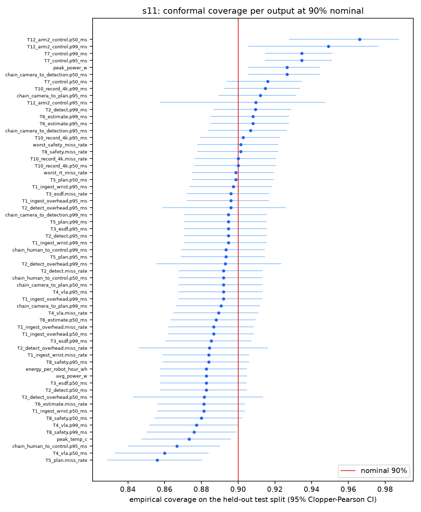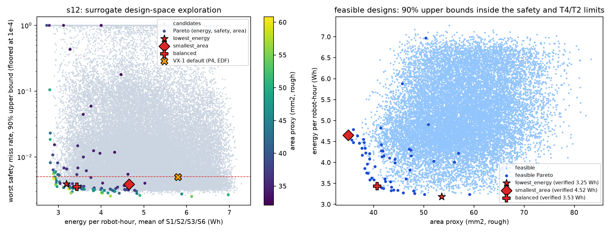<figcaption>Figure 8. Left (s11): empirical coverage per output on the held-out test split at 90% nominal, with Clopper-Pearson intervals. Right (s12): energy, worst safety miss upper bound and area proxy over the candidate designs, with the Pareto set and the recommendations.</figcaption></figure> <!-- src: results/s11.json#summary.nominal|pct -->

**Design-space exploration (s12).** I scored 60,000 candidate designs on S1, S2, S3 and S6 and kept those whose 90% upper bounds keep safety misses under 0.5% and VLA and detection misses under 5% on every workload: 10,678 qualify. I then re-ran three recommendations with the full model at 2 s and 6 s on all four workloads. All had zero safety, VLA and detection misses, and all interval checks but one landed inside the intervals (the lowest-energy design's VLA p99 on S6 came in at 90.9 ms against an upper bound of 90.0 ms). <!-- src: results/s12.json#setup.n_candidates --> <!-- src: results/s11.json#summary.nominal|pct --> <!-- src: results/s12.json#setup.safety_limit|pct --> <!-- src: results/s12.json#setup.rt_limit|pct --> <!-- src: results/s12.json#counts.feasible --> <!-- src: results/s12.json#recommended[0].verified.interval_checks[15].full_model --> <!-- src: results/s12.json#recommended[0].verified.interval_checks[15].hi -->

| Design | Area proxy | Energy, surrogate | Energy, full model (6 s) |
|---|---|---|---|
| Lowest energy (4 tiles of 128x128, NPU Vmin 0.47 V, race to idle) | 50.8 mm2 | 2.61 Wh | 2.67 Wh <!-- src: results/s12.json#recommended[0].design.vmin_npu --> <!-- src: results/s12.json#recommended[0].predicted.area_mm2 --> <!-- src: results/s12.json#recommended[0].predicted.energy_wh_mean --> <!-- src: results/s12.json#recommended[0].verified.energy_wh_mean_6s --> |
| Smallest area (3 tiles of 88x88) | 36.6 mm2 | 3.39 Wh | 3.19 Wh <!-- src: results/s12.json#recommended[1].predicted.area_mm2 --> <!-- src: results/s12.json#recommended[1].predicted.energy_wh_mean --> <!-- src: results/s12.json#recommended[1].verified.energy_wh_mean_6s --> |
| Balanced (4 tiles of 120x120, 2 MB cache) | 40.1 mm2 | 2.85 Wh | 2.84 Wh <!-- src: results/s12.json#recommended[2].predicted.area_mm2 --> <!-- src: results/s12.json#recommended[2].predicted.energy_wh_mean --> <!-- src: results/s12.json#recommended[2].verified.energy_wh_mean_6s --> |
| VX-1 default under P4, reference only (Vmin floors at nominal, so P4 cannot lower voltage) | 47.9 mm2 | 5.14 Wh | 5.51 Wh <!-- src: results/s12.json#baseline_vx1_p4_edf.area_mm2 --> <!-- src: results/s12.json#baseline_vx1_p4_edf.predicted_energy_wh_mean --> <!-- src: results/s12.json#baseline_vx1_p4_edf.verified_energy_wh_mean_6s --> |

The VX-1 default row is not a fair baseline for the winners: its Vmin floors sit at nominal, so P4 has no voltage range to use there. I list it only as a reference point and do not quote a saving against it. All three winners use a wide NPU at reduced voltage, about 72 to 78 GB/s of DRAM bandwidth, QoS and race to idle. The area model is a rough proxy from public density figures. A full-model design point costs a median 4.3 CPU seconds; the exported ONNX surrogate evaluates every output with its interval in well under a millisecond in the browser, which is what makes the sliders interactive. <!-- src: results/s12.json#recommended[0].design.dram_gbps --> <!-- src: results/s12.json#recommended[1].design.dram_gbps --> <!-- src: results/s11.json#dataset.sample_cpu_s_median -->

## 11. RISC-V study (s13)

The planner's collision check normally runs on the SIMT cluster. I asked what happens if it has to run on the RV64 application cores, and whether a custom instruction helps.

**RVV kernels.** I wrote cuRobo-style forward kinematics, sphere-versus-ESDF collision and sphere self-collision kernels in scalar C and RVV intrinsics and ran them in gem5 (VLEN 256, O3 and Minor cores). All 27 verification runs match the host reference bit for bit. RVV speeds the planner kernels up about 4x to 6x; the control step barely changes because the Newton-Euler chain is serial. gem5's vector timing is coarse, so the O3 vector numbers are optimistic. <!-- numcheck: ignore (counts of runs and rounded ranges from riscv/tables, stated in riscv/README.md) -->

**`xcol.sdf`.** I defined one custom instruction, a fused sphere-versus-distance-field lookup, in a custom-0 extension of my own local copy of the RISC-V Unified Database (UDB). Its IDL passes UDB's schema, encoding-conflict and IDL type checks, and I implemented it bit-exactly in gem5 with an assumed fixed latency and issue rate. On the ESDF kernel it is 2.9x faster than RVV on the in-order core and 2.0x on the out-of-order core. If its eight corner reads paid every L1 miss the scalar kernel took, it would lose to RVV on the out-of-order core, and I did not build the timed memory path that would settle that. <!-- src: results/s13.json#headline.esdf_xcol_vs_rvv_minor --> <!-- src: results/s13.json#headline.esdf_xcol_vs_rvv_o3 -->

**End to end.** With collision moved to eight app cores, T5 alone takes 152.5 ms with scalar code (a miss against 50 ms), 33.1 ms with RVV and 25.8 ms with RVV plus `xcol.sdf`, against 8.7 ms on SIMT. In S3, where a person entering triggers a replan burst, the replans in the following second average 40.9 ms with RVV and 32.2 ms with the instruction, a 21% reduction, against 10.7 ms on SIMT. Self-collision is about half of the CPU collision work and the instruction does not touch it, which caps the gain. On VX-1 as configured, the accelerator is the right place for collision checking; the instruction is a design-space data point, not a recommendation. <!-- src: results/s13.json#headline.t5_alone_ms.scalar --> <!-- src: results/s13.json#headline.t5_deadline_ms --> <!-- src: results/s13.json#headline.t5_alone_ms.rvv --> <!-- src: results/s13.json#headline.t5_alone_ms.xcol --> <!-- src: results/s13.json#headline.t5_alone_ms.simt --> <!-- src: results/s13.json#headline.s3.rvv.t5_after_human_enter_mean_ms --> <!-- src: results/s13.json#headline.s3.xcol.t5_after_human_enter_mean_ms --> <!-- src: results/s13.json#headline.s3_burst_xcol_vs_rvv_reduction_pct --> <!-- src: results/s13.json#headline.s3.simt.t5_after_human_enter_mean_ms -->

<figure class="pair">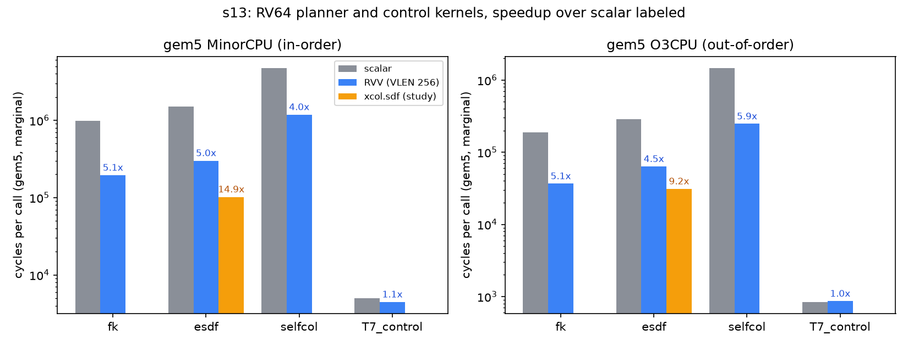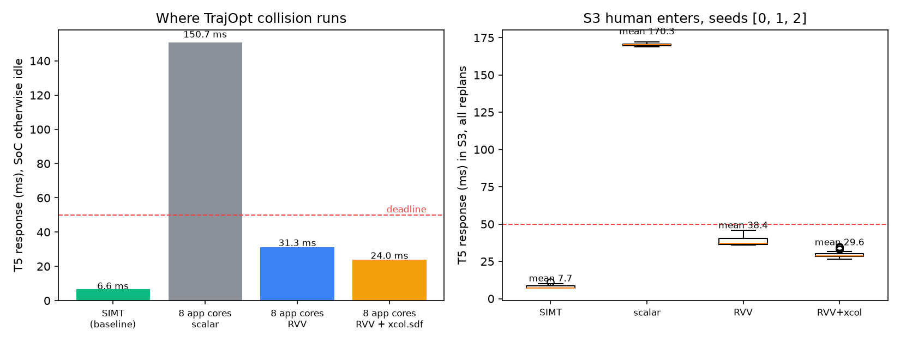<figcaption>Figure 9 (s13). Left: gem5 cycles per call for scalar, RVV and xcol.sdf kernels. Right: T5 replan latency by collision mapping, alone and in S3.</figcaption></figure> <!-- numcheck: ignore (figure number) -->

## 12. Limitations

- **VX-1 is fictional.** It is inspired by public descriptions of physical-AI SoCs, and every parameter is an assumption. Nothing here describes any company's chip, workloads or numbers.
- **Accuracy is relative to reference simulators, not silicon.** The fast L1 model misses its 10% mean target. Tier B, with Ramulator 2 and BookSim 2 in the loop, covers only 40 ms of one scenario. <!-- src: results/s10.json#analysis.acceptance.L1_mean_target|pct --> <!-- src: results/s10.json#setup.tier_b_s1_window_s|scale=1000 --> The Orin-like comparison is a sanity check, and ResNet-50 misses it.
- **Behavior comes from a scripted expert in hybrid mode.** The VLA's compute is modeled from SmolVLA's real operator graph; its decisions are not. Perception is a noisy ground-truth snapshot with frustum checks and no occlusion. The disturbance model sets the shape of the latency-tolerance curve.
- **cuRobo and ROS 2 are fallbacks.** Planner graphs come from operation counts checked against published timings, not GPU profiles, and middleware costs were measured on a Mac and scaled by an assumed factor.
- **The assumed enclosure is marginal.** At 45 C ambient VX-1 has no thermal steady state at nominal power; this is a property of assumed enclosure parameters, not a measurement.
- **Power numbers are model numbers.** The per-operation energies are scaled from published tables, the thermal network is lumped, and leakage ignores DIBL. The voltage cliff is deadline-driven only. The low-voltage arithmetic factor is hypothetical.
- **The surrogate's guarantee is marginal and in-distribution.** Measured coverage under the two shifts I tested is below nominal for some outputs.
- **Short runs.** Surrogate samples are 2 s with a 1 s burn-in, so rare events longer than that are not sampled.

## Corrections

**Thermal start in the runner (fixed).** An earlier version of `studies/runner.py` started every run at a thermal steady state computed for a placeholder workload (each domain's clock tree and leakage at nominal plus 30 percent of peak dynamic power), not for the run's own workload. That put the junction near 86 C at the start of every short run and inflated leakage, so S1 at nominal read about 6.09 W in the superseded files. <!-- numcheck: ignore (superseded value, kept as a record) -->
The corrected S1 nominal power is 4.51 W. <!-- src: results/s01.json#headline.s1_avg_power_w -->
The bug affected s01-s05, s09, s16 and the replays; s06-s08 already used the settled start and did not change. The fix makes `thermal_init="settle"` the default (after a 1 s burn-in, the thermal state jumps to the steady state for the run's own measured power), and `"steady"` now requires an explicit power. After regenerating, timing results are unchanged except where throttling occurs: the 45 C fast-conveyor case, the S5 replay, and the 96 Gbit/s points of s04, where the EDF variants now throttle and miss. Every number in this report is from the regenerated files.

## 13. Future work

- Replace the fixed-IPC L1 CPU model with per-kernel CPI tables learned from gem5, which s10 suggests would close most of the L1 mean-latency gap.
- Model head-of-line blocking inside routers so the L1 NoC saturates where BookSim does under uniform traffic.
- Run a learned VLA closed loop on rented or donated GPU time, keeping hybrid mode as the baseline.
- Profile cuRoboV2 on a real GPU and record ROS 2 middleware costs with ros2_tracing on an arm64 board.
- Time `xcol.sdf`'s memory reads through gem5's caches, and try finer-grained NPU preemption to see how much of the VLA's p99 under contention is preemption granularity.
- Add timing-error physics so the voltage cliff can come from logic failures as well as deadlines.
